# NoteToGrid

[](https://github.com/AayatHossain/note-to-grid/actions/workflows/tests.yml)

**An API that reads plain-English notes from a campus energy operator, turns them into rules with an LLM, checks every rule in code, and returns the cheapest valid 24-hour plan for the campus battery and grid.**

## The problem

A campus with rooftop solar and a battery has to decide, hour by hour, when to buy power from the grid, when to charge the battery and when to use it. Power is cheap at night and expensive in the evening, so a good plan saves real money. A linear-programming optimizer can find the cheapest plan exactly.

The hard part is that conditions change every day, and operators describe them in plain words:

> *"Panel washing is scheduled from 10 AM to noon; plan on roughly 40% of the usual solar output."*
> *"Relay testing tonight: the battery must not discharge from 7 PM to 9 PM."*
> *"The cafeteria menu changes on Friday."*

An optimizer cannot read these. A language model can, but it sometimes gets things wrong, and a wrong rule can break the battery's limits or waste money.

## How this project helps

| Step | Who does it | Why |
|---|---|---|
| Read each note and turn it into a rule | **LLM** (one call per request) | Understands any wording: "80% reduction", "half the battery", "6 PM until 9 PM" |
| Check every rule | **Plain code (guardrails)** | Rejects anything impossible; a note that stays wrong is safely ignored, never guessed |
| Find the cheapest plan | **Linear-programming optimizer** | The exact minimum cost, not an estimate, in about 2 ms |
| Check the final plan | **Plain code (validator)** | Replays the plan hour by hour before it is sent |

The LLM only reads the notes. It never sees or changes the demand, the prices or the battery limits, and nothing it returns is used without passing the checks.

## Example

**Request** ([data/sample_request.json](data/sample_request.json)): two notes, plus 24 hours of demand, solar forecast and grid prices, and the battery limits.

```json
{
  "scenario_id": "EXAMPLE-01",
  "operator_notes": [
    "Panel washing is scheduled from 10 AM to noon; plan on roughly 40% of the usual solar output.",
    "The cafeteria menu changes on Friday."
  ],
  "hours": [ {"hour": 0, "demand_kwh": 85, "solar_kwh": 0, "tariff_bdt_per_kwh": 5}, "... 23 more hours" ],
  "battery": { "capacity_kwh": 220, "initial_energy_kwh": 110, "minimum_energy_kwh": 40,
               "max_charge_kwh_per_hour": 50, "max_discharge_kwh_per_hour": 50 }
}
```

**Response** (shortened):

```json
{
  "directive_interpretation": [
    { "note_index": 0, "applies": true, "directive_type": "solar_reduction",
      "structured_adjustment": {"hours": [10, 11], "factor": 0.4},
      "explanation": "Washing leaves 40% of solar from 10 AM to noon." },
    { "note_index": 1, "applies": false, "directive_type": "no_op",
      "structured_adjustment": null,
      "explanation": "A menu change does not affect today's energy plan." }
  ],
  "hourly_plan": [
    { "hour": 18, "grid_kwh": 140.0, "solar_used_kwh": 0.0, "battery_action": "discharge",
      "battery_kwh": 50.0, "battery_energy_after_kwh": 140.0 },
    "... all 24 hours"
  ],
  "total_grid_kwh": 2403.0,
  "total_cost_bdt": 19729.0,
  "peak_grid_kwh": 145.0,
  "plan_summary": "Applied solar reduced to 0.4x in hours 10-11. 1 note(s) treated as no_op. ..."
}
```

The first note becomes a rule. The second is recognised as unrelated and ignored. The plan charges the battery when power is cheap and uses it in the expensive evening hours.

## What it guarantees

| Guarantee | How |
|---|---|
| **Always the cheapest valid plan** | The schedule is a linear program solved exactly by HiGHS, so no cheaper valid plan exists |
| **Never breaks a battery or grid limit** | Every plan is replayed hour by hour against all limits before it is returned |
| **Never acts on a bad model answer** | Guardrails check every field; a rejected note gets one retry, then is safely ignored |
| **Never crashes on model failure** | Timeouts, provider errors and garbage replies all lead to a valid plan; the API still answers |
| **Answers within 30 seconds** | A 20 s limit per model call inside a 22 s total budget |
| **Works with several providers** | OpenAI, Anthropic, or any OpenAI-compatible API (Groq, Gemini, OpenRouter, Ollama) |

All of this is covered by 35 automated tests that run without an API key.

## How it works

```mermaid
flowchart LR
    R["Request<br/>notes + 24 h data + battery"] --> V["Check request<br/>400 / 422 on bad input"]
    V --> L["LLM<br/>notes to rules"]
    L --> G["Guardrails<br/>check every rule"]
    G -- "rejected" --> L
    G --> C["Constraint builder<br/>rules to hourly limits"]
    C --> O["LP optimizer<br/>cheapest plan"]
    O --> P["Plan builder<br/>rounding, totals"]
    P --> F["Final validator<br/>replay every hour"]
    F --> S["Response"]
```



### The six rule types

| Rule | Example note | What it changes |
|---|---|---|
| `solar_reduction` | "Haze will cut solar output by 30% from 9 AM to 1 PM" | Usable solar in those hours (factor 0.7) |
| `minimum_battery_reserve` | "Keep at least 60% of the battery in reserve from 5 PM to 8 PM" | The lowest the battery may go (60% of capacity, in kWh) |
| `no_charge_window` | "The charger is offline from midnight until 6 AM" | No charging in those hours |
| `no_discharge_window` | "The battery must not discharge from 7 PM to 9 PM" | No discharging in those hours |
| `max_grid_window` | "Grid import is limited to 160 kWh per hour from 6 PM to 10 PM" | A cap on grid power in those hours |
| `no_op` | "The cafeteria menu changes on Friday" | Nothing; the note is unrelated |

### The guardrails

The model's answer is treated as untrusted. Code checks that:
- there is exactly one answer per note, in order;
- the rule type is one of the six above;
- time windows are real hours (midnight wrap-around and "all day" are handled by code, not the model);
- numbers are in range: solar factor between 0 and 1, reserve no more than the battery's capacity, grid cap not negative.

A note that fails is sent back to the model once, with the reason. If it fails again, it is treated as unrelated and the plan is built without it. A solar rule that falls entirely at night (an AM/PM mix-up) is also sent back, with the day's real daylight hours.

### The optimizer

For each hour, the optimizer chooses three numbers: grid power, solar used, and battery charge or discharge. It finds the combination with the lowest total grid cost such that:
- grid + solar + battery output always meets demand;
- the battery stays between its minimum and its capacity, and charges or discharges no faster than its limits;
- every rule from the notes is respected;
- the battery ends the day where it started.

If the rules contradict each other (only possible when a note was misread), it drops the fewest rules needed and says so in the plan summary.

## Built with

| Area | Tools |
|---|---|
| API | FastAPI, Uvicorn, Pydantic v2 |
| LLM | OpenAI and Anthropic Python SDKs, strict JSON-schema output |
| Optimization | SciPy `linprog` with the HiGHS solver, NumPy |
| Testing | pytest, httpx, a fake LLM for offline tests |
| Delivery | Docker (non-root, health check), GitHub Actions for tests and image builds |

## Terms used

<details>
<summary>Show the glossary</summary>

| Term | Meaning |
|---|---|
| LLM | Large language model, such as GPT-4.1 or Claude, that reads and writes text |
| Operator note | A short plain-English message from the person running the campus energy system |
| Directive / rule | One structured instruction taken from a note, such as "no charging from 1 AM to 4 AM" |
| Guardrails | Plain-code checks that accept or reject the model's answer |
| Linear programming (LP) | A method that finds the exact best value of a cost when all the limits are straight-line equations |
| HiGHS | The open-source LP solver used through SciPy |
| kWh | Kilowatt-hour, a unit of energy |
| Tariff | The grid price per kWh in each hour, here in Bangladeshi taka (BDT) |
| Reserve | The minimum energy the battery must keep stored |
| Strict JSON schema | A setting that forces the model to reply in an exact JSON shape |

</details>

## Repository layout

```
app/
  main.py          API endpoints, error handling and the request pipeline
  llm.py           prompt, JSON schema, provider backends, retry, time budget, cache
  guardrails.py    checks on the model's answer
  directives.py    the six rule types and how they become hourly limits
  optimizer.py     linear program, plan builder and totals
  validator.py     hour-by-hour replay of a plan
  schemas.py       request and response models
  config.py        settings from environment variables
data/
  examples.json        12 example days with notes, expected rules and optimal cost
  sample_request.json  one ready-to-send request
scripts/
  evaluate.py      scores a running service with the real LLM
  make_examples.py rebuilds data/examples.json
tests/             35 offline tests
```

## Getting started

Python 3.11 or newer and an OpenAI API key.

```bash
git clone https://github.com/AayatHossain/note-to-grid.git
cd note-to-grid
python -m venv .venv && source .venv/bin/activate   # Windows: .venv\Scripts\activate
pip install -r requirements.txt

export OPENAI_API_KEY=sk-...                        # PowerShell: $env:OPENAI_API_KEY="sk-..."
uvicorn app.main:app --port 8000
```

Then open **http://localhost:8000/docs** to try the API in the browser, or send the sample request:

```bash
curl -X POST http://localhost:8000/optimize-energy -H "Content-Type: application/json" -d @data/sample_request.json
```

With Docker instead:

```bash
docker build -t notetogrid .
docker run --rm -p 8000:8000 -e OPENAI_API_KEY=sk-... notetogrid
```

<details>
<summary><b>All settings</b></summary>

Copy `.env.example` to `.env`, or set these as environment variables.

| Setting | Default | Meaning |
|---|---|---|
| `LLM_PROVIDER` | `openai` | `openai` (or any OpenAI-compatible API), `anthropic`, or `none` (every note is ignored) |
| `LLM_MODEL` | `gpt-4.1` | Model name. `gpt-4.1-mini` is about 5x cheaper |
| `OPENAI_API_KEY` | | Needed for `openai` |
| `ANTHROPIC_API_KEY` | | Needed for `anthropic` |
| `LLM_BASE_URL` | | An OpenAI-compatible endpoint, e.g. Groq, Gemini, OpenRouter or a local Ollama |
| `LLM_FALLBACK_MODEL` | | A second model tried if the first one fails |
| `LLM_TIMEOUT_SECONDS` | `20` | Limit for one model call |
| `LLM_TOTAL_BUDGET_SECONDS` | `22` | Limit for all model calls in one request |
| `LLM_CACHE_SIZE` | `512` | How many note interpretations to remember (`0` turns it off) |
| `PORT` | `8000` | Port to listen on |

</details>

## Testing

**Offline tests** need no API key, no network and cost nothing:

```bash
pip install -r requirements-dev.txt
python -m pytest
```

A fake LLM returns the correct rules for each of the 12 example days, and the tests check that the API returns a valid plan at exactly the optimal cost. They also cover bad requests (400), impossible batteries (422), running with no LLM, and guardrail rejections.

**Live evaluation** runs the real LLM against the same 12 days. Start the service, then:

```bash
python scripts/evaluate.py --base-url http://localhost:8000
```

It reports how many notes were read correctly, how many plans were valid, how far each cost is from the optimum, and the response time. A full run costs about USD 0.05 with `gpt-4.1`.

## API

| Endpoint | Purpose |
|---|---|
| `GET /health` | Returns `{"status": "ok"}` |
| `POST /optimize-energy` | Reads the notes and returns the rules and the 24-hour plan |
| `GET /docs` | Interactive API page |

| Status | When |
|---|---|
| `200` | Plan returned |
| `400` | Malformed JSON, or missing or invalid fields |
| `422` | Valid JSON but an impossible battery, e.g. a minimum above the starting level |
| `500` | Unexpected error; no internal details are returned |

API keys are read only from the environment and never logged or returned.

## License

[MIT](LICENSE)
